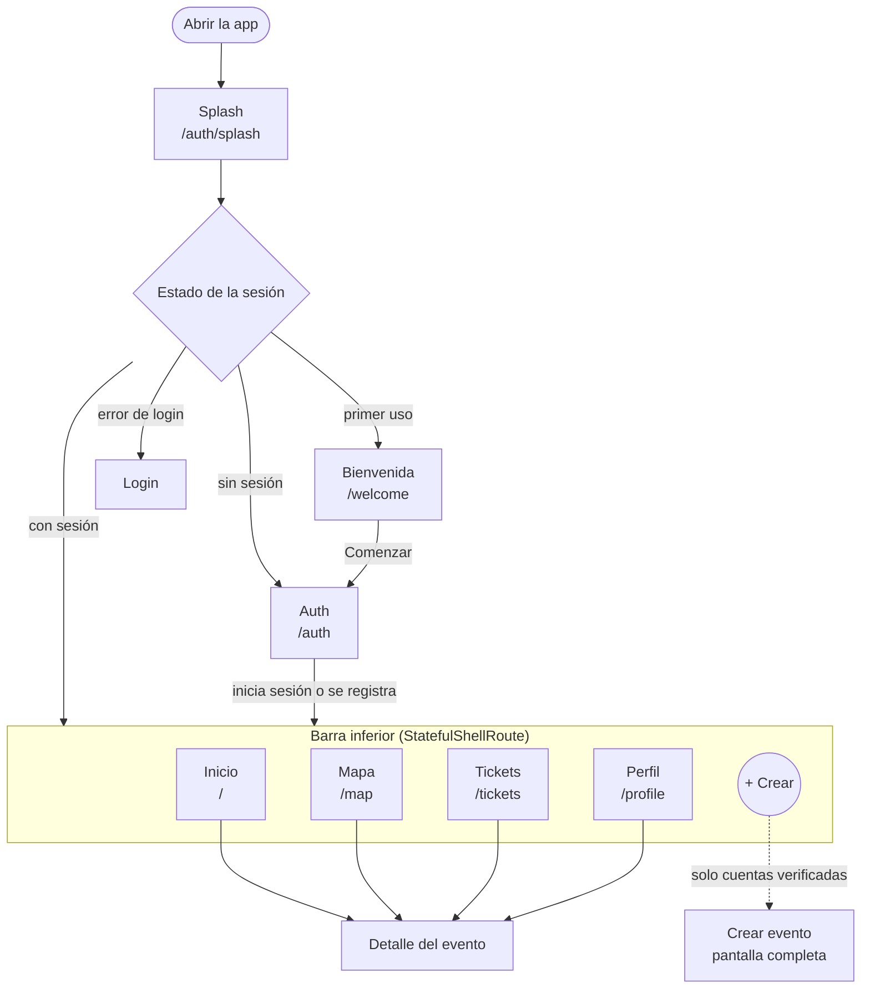
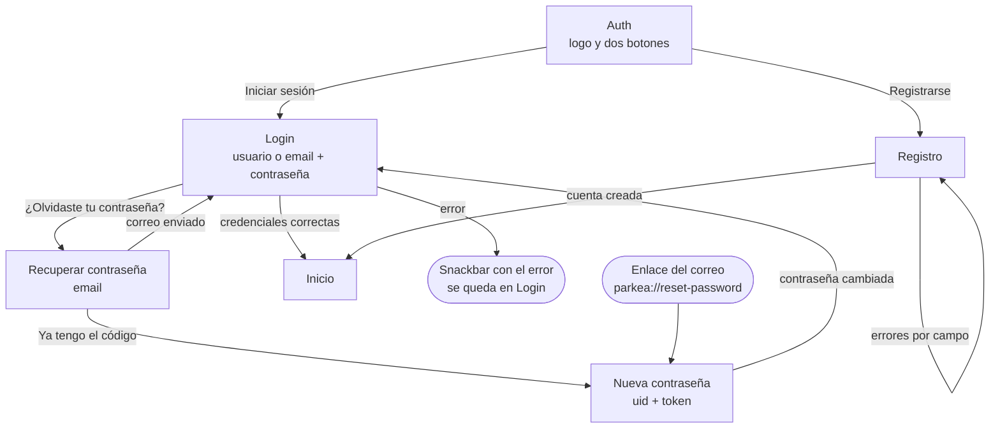
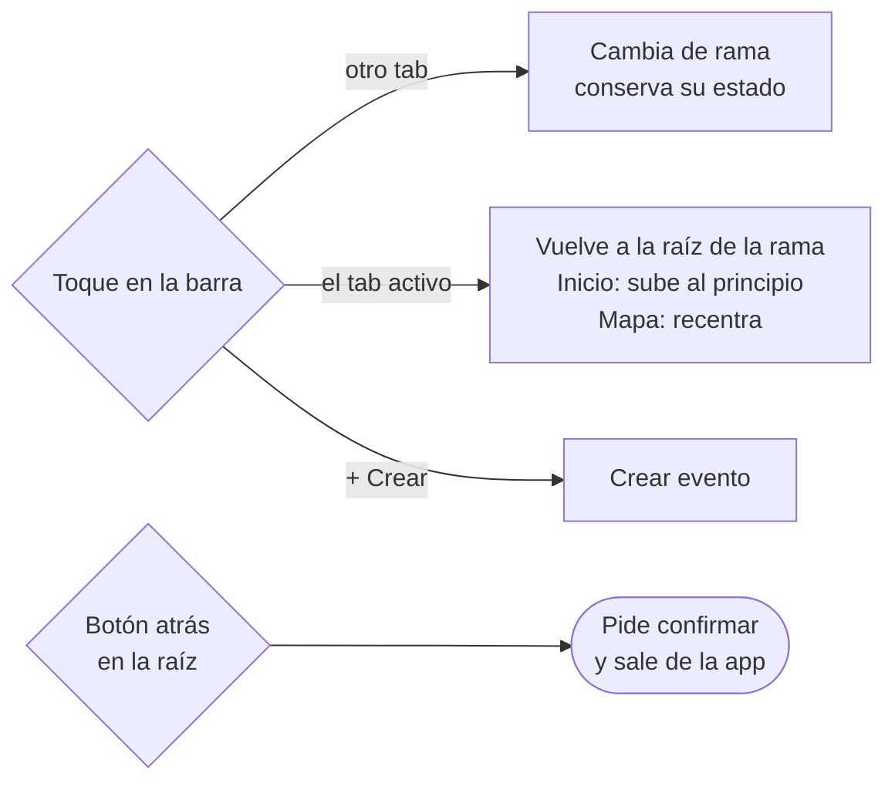
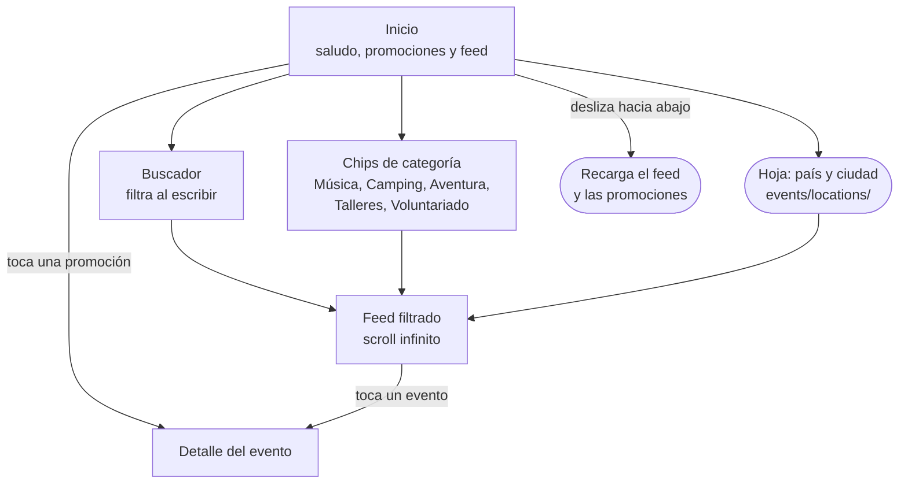
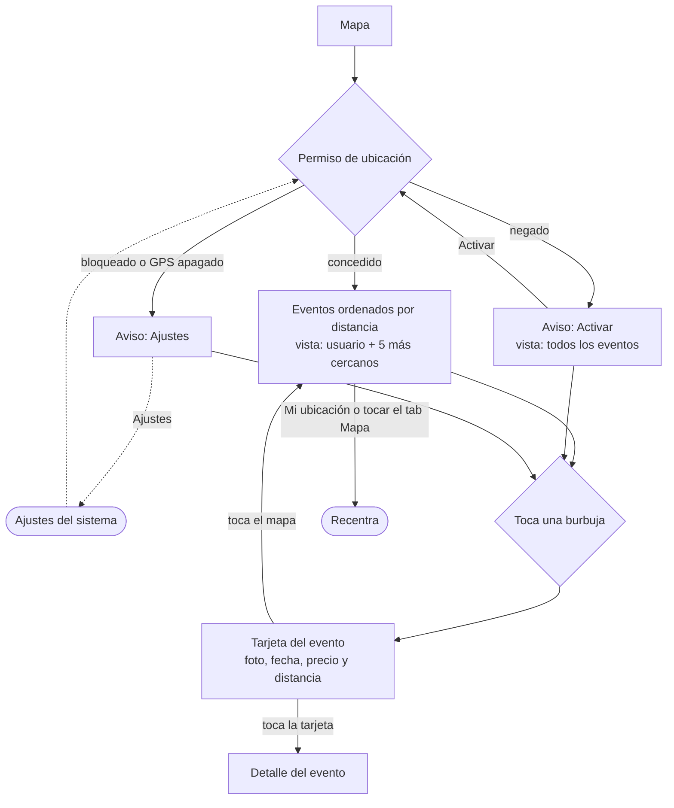
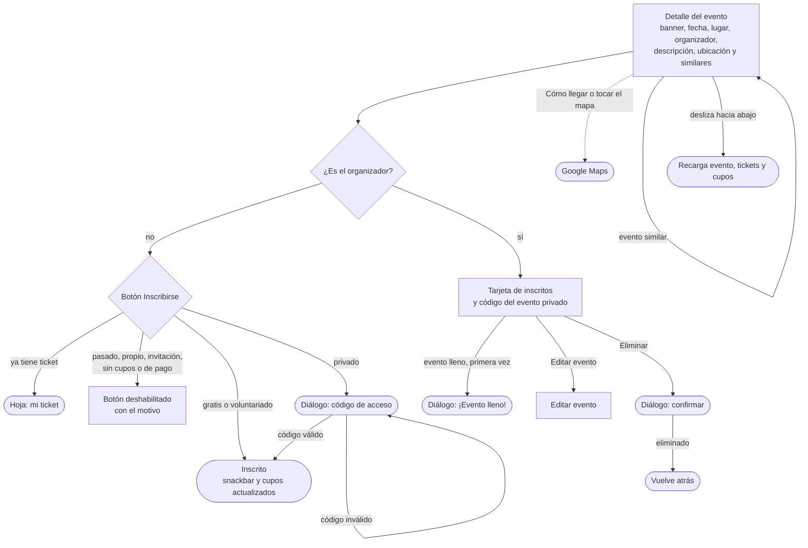
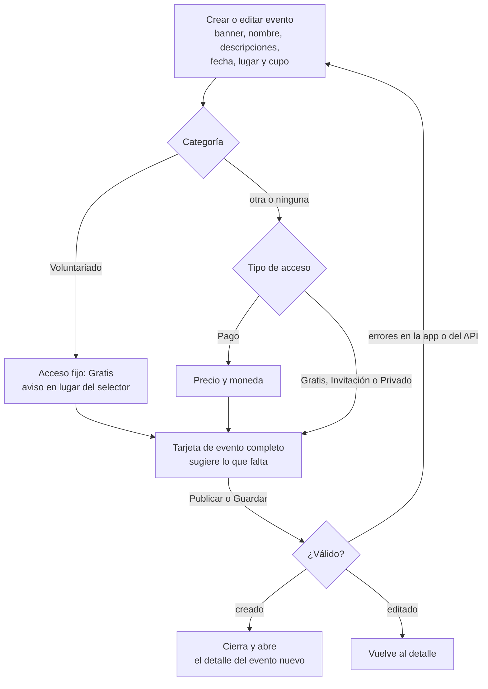
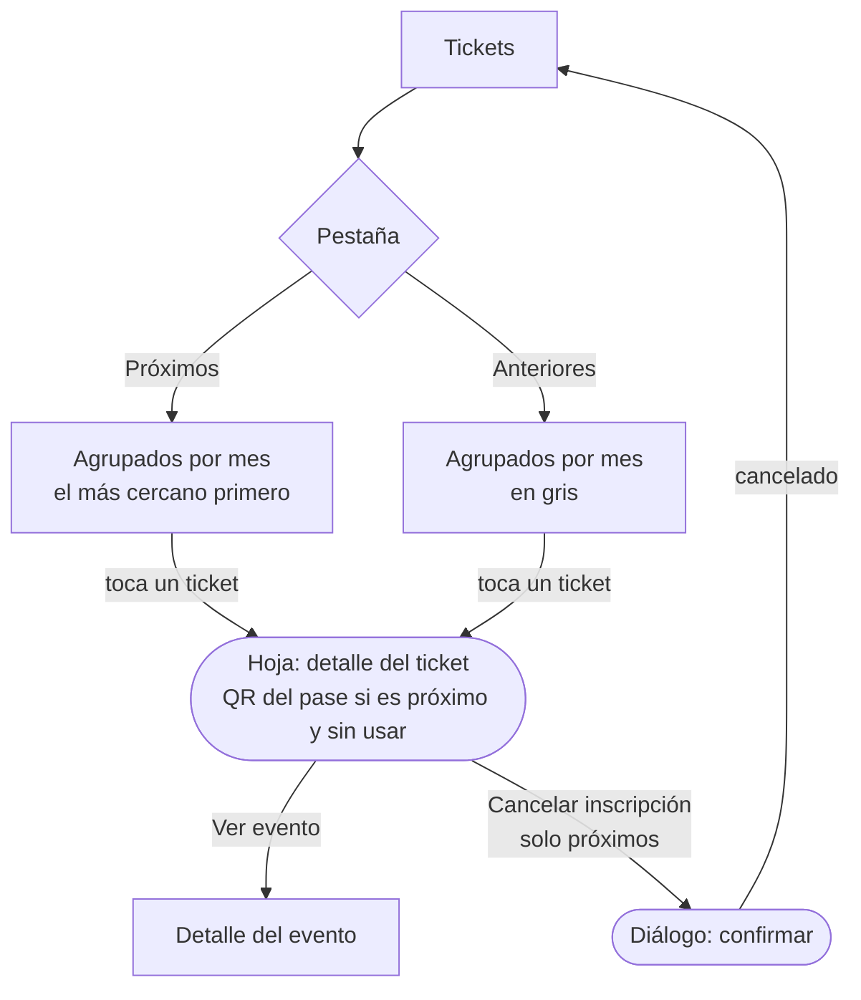
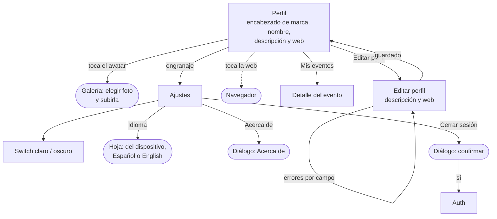

# Flujo de pantallas

Diagramas de navegación por pantalla, sacados del código (`lib/domain/routers/app_router.dart` y las llamadas `pushNamed`/`goNamed`/`showDialog` de cada pantalla). Están en Mermaid: GitHub y Android Studio los muestran como diagramas.

**Leyenda:** los rectángulos son pantallas, los rombos son decisiones, los bloques redondeados son diálogos u hojas inferiores, y las líneas punteadas salen de la app (navegador, mapas, ajustes del sistema).

## 1. Mapa general

La sesión decide dónde empieza la app: el `redirect` del router escucha el estado de `restAuthUC`.

## 2. Autenticación

Usa `AuthTheme` (el diseño anterior, congelado). Con sesión, cualquier ruta de auth redirige al Inicio.

## 3. Barra inferior

Inicio, Mapa, Tickets y Perfil son ramas del router y cada una conserva su pila. "Crear" es una acción: solo aparece si `is_verified`, y entonces queda al centro. Sin verificar, la barra tiene 4 tabs.

## 4. Inicio

## 5. Mapa

## 6. Detalle del evento

Es el mismo para todos; cambian las acciones según quién lo ve y el tipo de acceso.

> El pago (`YappyPaymentPage`) existe en el código, pero ninguna pantalla lo abre todavía: los eventos de pago muestran "Pagos próximamente".

## 7. Crear y editar evento

A pantalla completa, sin la barra inferior.

## 8. Tickets

## 9. Perfil, Editar perfil y Ajustes

La tarjeta "Tu perfil" y las filas Notificaciones, Ayuda y Privacidad de Ajustes todavía no llevan a ninguna pantalla.
